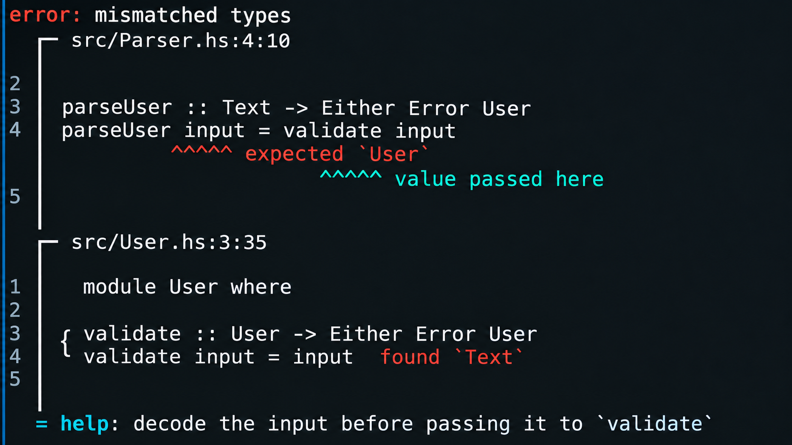

# Tadka

**Tadka** turns ordinary error values into readable diagnostic reports: source
snippets with labelled spans, error codes, help text, related diagnostics, and
underlying causes. The same diagnostic can be shown as a graphical terminal
report, as accessible prose, or as JSON.

It is for compilers, parsers, command-line tools, static analysers, DSLs, and
other developer tooling. It is inspired by Rust's
[`miette`](https://github.com/zkat/miette) and built around Haskell's types and
conventions.



Tadka adds a reporting layer to the error types you already have. It does not
replace `Either`, `ExceptT`, or exceptions: add a `Diagnostic` instance to say
how an error should be presented, and keep propagating it however you like.

## Quick start

Add these to `build-depends` of an executable (the messages are
[`prettyprinter`](https://hackage.haskell.org/package/prettyprinter) documents,
and the example builds its source text with `text`):

```cabal
build-depends:
    base
  , prettyprinter
  , tadka
  , text
```

This is a complete program. Put it in `Main.hs` and run it:

```haskell
{-# LANGUAGE OverloadedStrings #-}

import           Data.List.NonEmpty (NonEmpty (..))
import           Data.Text          (Text)
import           Prettyprinter      (pretty)
import           Tadka

-- | What went wrong, and where.
data UnboundVariable = UnboundVariable
  { uvName   :: Text
  , uvSource :: NamedSource
  , uvAt     :: Span
  }

-- A diagnostic code is checked when it is built, so keep it in one place.
unboundCode :: DiagnosticCode
unboundCode = either (error . show) id (mkDiagnosticCode "demo::E0001")

instance Diagnostic UnboundVariable where
  message e = pretty ("unbound variable " <> uvName e)
  code _    = Just unboundCode
  help _    = Just (pretty ("check the spelling, or import the name" :: Text))
  context e = mkContextDegrading (uvSource e)
                (Labeled (uvAt e) Primary (Just (pretty ("not in scope" :: Text))) :| [])

-- | @quantity@ is the eight characters starting at offset 20.
demo :: UnboundVariable
demo = UnboundVariable "quantity" source at
  where
    source = either (error . show) id (mkNamedSource "demo.hs" "let total = price * quantity\n")
    at     = either (error . show) id (mkSpan 20 8)

main :: IO ()
main = reportDiagnostic defaultConfig demo
```

Printed to a terminal, the report is drawn like this (without colour here, so
that it can be shown as text):

<!-- output: quickstart -->
```text
error[demo::E0001]: unbound variable quantity
  ┌─ demo.hs:1:21
  │
1 │ let total = price * quantity
  │                     ^^^^^^^^ not in scope
  │
  = help: check the spelling, or import the name
```

The error type is an ordinary record. The `Diagnostic` instance describes it:
only `message` is required, and everything else has a default. `context` says
*where* the error is, as a source plus labelled spans. `reportDiagnostic` prints
the report, and `defaultConfig` picks colour and Unicode drawing from the
terminal it is printing to.

### Diagnostic codes

A code is a lowercase namespace, `::`, the letter `E`, and at least four digits,
such as `demo::E0001`. `mkDiagnosticCode` returns a `Left` for anything else.
Build each code once, at the top level, as above. With `deriveDiagnostic`, below,
a malformed code is a compile-time error instead.

## Deriving the instance

When the diagnostic information follows the shape of your error type, derive the
instance with Template Haskell. A record update on `defaultSpec` describes the
fields:

```haskell
data TypeMismatch = TypeMismatch
  { tmSource   :: NamedSource
  , tmAt       :: Span
  , tmExpected :: Text
  , tmActual   :: Text
  }
  deriving (Show)

deriveDiagnostic defaultSpec
  { specCode        = Just "demo::E0002"
  , specHelp        = Just "convert one side explicitly"
  , specSourceField = Just 'tmSource
  , specLabelFields = [('tmAt, "type mismatch here")]
  , specMessage     = Just [| \e -> pretty ("expected " <> tmExpected e <> ", found " <> tmActual e) |]
  }
  ''TypeMismatch
```

or the same thing as a flat list, with `diagnosticSpec`:

```haskell
data ArityError = ArityError
  { aeSource :: NamedSource
  , aeCall   :: Span
  , aeWanted :: Int
  , aeGiven  :: Int
  }
  deriving (Show)

deriveDiagnostic
  (diagnosticSpec
     [ diagCode "demo::E0003"
     , diagHelp "remove the extra arguments"
     , diagSource 'aeSource
     , diagLabel 'aeCall "called here"
     , diagMessage [| \e -> pretty ("expected " <> T.pack (show (aeWanted e))
                                    <> " arguments, got " <> T.pack (show (aeGiven e))) |]
     ])
  ''ArityError
```

The two forms build the same `DiagnosticSpec` and can be mixed freely. Field
names are checked against the record when the splice runs, so a misspelt field,
a field of the wrong type, or a malformed code is a compile-time error. Without
`specMessage` the message is `pretty . show`, which needs a `Show` instance.

Printing both gives:

<!-- output: derive -->
```text
error[demo::E0002]: expected Int, found Text
  ┌─ demo.hs:1:17
  │
1 │ total = count + "1"
  │                 ^^^ type mismatch here
  │
  = help: convert one side explicitly

error[demo::E0003]: expected 2 arguments, got 3
  ┌─ demo.hs:1:1
  │
1 │ area 3 4 5
  │ ^^^^^^^^^^ called here
  │
  = help: remove the extra arguments
```

The tutorial covers every `DiagnosticSpec` field, secondary labels, label
collections whose length is only known at run time, causes, related diagnostics,
and deriving a whole family of errors from one sum type with
`deriveDiagnosticSum`.

## Output formats

Three output targets are selected with `withTarget`:

```haskell
-- | Choose the output format with 'withTarget'.
narratableConfig, jsonConfig :: Config
narratableConfig = withTarget TNarratable defaultConfig
jsonConfig       = withTarget TJson defaultConfig
```

`TGraphical` is the report shown above and is the default. `TNarratable` writes
the same information as prose, for screen readers and logs:

<!-- output: format-narratable -->
```text
Error, code demo::E0001: unbound variable quantity.
Location: demo.hs, line 1, column 21.
Source line 1: "let total = price * quantity".
The problem is at columns 21 through 28, labeled: not in scope.
Help: check the spelling, or import the name
```

`TJson` writes machine-readable JSON:

<!-- output: format-json -->
```text
{"causes":[],"code":"demo::E0001","cycleOmitted":false,"help":"check the spelling, or import the name","labels":[{"column":21,"file":"demo.hs","length":8,"line":1,"primary":true,"stale":false,"text":"not in scope"}],"message":"unbound variable quantity","related":[],"schemaVersion":1,"severity":"error","truncated":false,"url":null}
```

The JSON has a `schemaVersion` field. It changes only when the shape of the
JSON changes in a way a consumer must handle, independently of the package
version. Currently it is `1`.

## Configuration

Start from `defaultConfig` and apply `with...` functions.

| Setting | Function | Default |
|---|---|---|
| Colour | `withColorMode` (`ColorAuto`, `ColorAlways`, `ColorNever`) | `ColorAuto`: on when the destination is a terminal |
| Unicode box drawing | `withUnicodeMode` | `UnicodeAuto`: on when the locale and the destination are UTF-8 |
| Clickable links | `withHyperlinkMode` | `HyperlinkNever`: terminals give no reliable way to ask |
| Related and cause depth | `withRelatedDepthLimit` | 8 |
| Tab width | `withTabWidth` | 4 |
| Context lines | `withContextLines` | unset: show the contiguous range |
| Label colours | `withLabelPalette` | built-in palette |
| Output format | `withTarget` | graphical |
| Cause detail | `withCauseDetail` (`CauseSummary`, `CauseFull`) | `CauseSummary`: one line per cause |
| Syntax highlighting | `withHighlighter`, `withoutHighlighter` | none |

`reportDiagnostic` prints to standard output. `reportDiagnosticTo` prints to any
`Handle`, such as `stderr`, and `renderDiagnosticTo` returns the report as
`Text`. Colour and Unicode are detected for the handle being written to, and
text that a handle's encoding cannot represent becomes `?` instead of raising an
exception.

## Highlighting source snippets

Tadka itself has no syntax highlighter. A `Highlighter` is a function from a
source's name and its lines to the same lines with colour added, and
`withHighlighter` plugs one in. This toy makes the word `let` cyan:

```haskell
-- | Receives the source's name and all its lines; returns one coloured line
-- per input line, or 'Nothing' to leave the source plain.
keywords :: Highlighter
keywords = Highlighter
  { highlighterName = "keywords"
  , runHighlighter  = \_ ls -> Just (map (T.replace "let" "\ESC[36mlet\ESC[0m") ls)
  }

-- | Colour must be on for a highlighter to run.
coloured :: Config
coloured = withHighlighter keywords (withColorMode ColorAlways (withUnicodeMode UnicodeAlways defaultConfig))
```

Whatever a highlighter returns, Tadka keeps a line only if removing its colour
codes gives back exactly the original line. A highlighter can add colour; it
cannot change the text, move a caret, or emit any other terminal escape
sequence. Highlighting does nothing under `ColorNever`.

For real highlighting, the separate [`tadka-highlight`](tadka-highlight/README.md)
package provides a highlighter backed by `skylighting`:

```haskell
config :: Config
config = withHighlighter (skylightingAuto pygments) defaultConfig
```

**`tadka-highlight` is GPL-2.0-only**, because `skylighting` is. `tadka` itself
is MIT and does not depend on either; see [Licence](#licence).

## Your own source representation

Spans point into a `SourceCode`. The built-in `NamedSource` is a strict `Text`
and a name, but any type with a `SourceCode` instance works, for example an
editor buffer that is never one big `Text`:

```haskell
-- | A named buffer: its lines, without line terminators.
data Buffer = Buffer
  { bufName  :: Text
  , bufLines :: [Text]
  }

-- A source always has at least one line, even when empty.
linesOf :: Buffer -> [Text]
linesOf b = if null (bufLines b) then [T.empty] else bufLines b

instance SourceCode Buffer where
  scName = bufName

  -- Length in code points, counting one character per line break.
  scLength b = T.length (T.intercalate "\n" (linesOf b))

  scLineCount b = length (linesOf b)

  -- A window of lines, 1-based and inclusive, clipped to what exists.
  scLines b (lo, hi) =
    [ (n, l) | (n, l) <- zip [1 ..] (linesOf b), n >= max 1 lo, n <= hi ]

  -- Line and column (both 1-based) of a code-point offset.
  scLocate b offset = go 1 offset (linesOf b)
    where
      go n o (l : rest)
        | o <= T.length l || null rest = LineCol n (o + 1)
        | otherwise                    = go (n + 1) (o - T.length l - 1) rest
      go n o []                        = LineCol n (o + 1)
```

Pass it wherever a source is expected:

```haskell
-- | A diagnostic whose source is the buffer.
data NameClash = NameClash Buffer Span

instance Diagnostic NameClash where
  message _ = pretty ("name defined twice" :: Text)
  context (NameClash buf at) =
    mkContextDegrading buf (Labeled at Primary (Just (pretty ("second definition" :: Text))) :| [])
```

<!-- output: custom-source -->
```text
error: name defined twice
  ┌─ scratch buffer:3:1
  │
3 │ x = 3
  │ ^ second definition
```

A diagnostic stores its sources as `SomeSource`, so a context can mix source
types. The derive macros accept a field of type `NamedSource` or `SomeSource`.

## Diagnostics without a type of their own

`adHoc` builds a diagnostic from text, `fromError` from any `Exception`, and
`wrapErr` wraps one diagnostic as the cause of another. `withCode`,
`withSeverity`, `withHelp`, `withUrl`, and `withSourceCode` fill in the rest:

```haskell
loadFailed :: AdHocDiagnostic
loadFailed =
    withHelp "check that the file exists and is readable"
  . withCode (either (error . show) id (mkDiagnosticCode "demo::E0004"))
  $ wrapErr "could not load the configuration" (fromError (userError "config.toml: not found"))
```

Any diagnostic can also be thrown and caught as an ordinary exception:

```haskell
-- | Throw it, catch it as a 'SomeDiagnostic', and print the report.
report :: IO ()
report =
  catchDiagnostic (throwDiagnostic loadFailed)
    (\(SomeDiagnostic e) -> reportDiagnostic defaultConfig e)
```

<!-- output: ad-hoc -->
```text
error[demo::E0004]: could not load the configuration
  = help: check that the file exists and is readable
  = caused by: user error (config.toml: not found)
```

`installPanicHook` makes an uncaught diagnostic exception print as a full
report on standard error, instead of GHC's default dump.

## Related diagnostics, causes, and several files

A diagnostic can carry `related` diagnostics and one underlying cause
(`diagnosticCause`), both as `SomeDiagnostic`. A cause is shown as one line by
default; `withCauseDetail CauseFull` shows each cause of the reported
diagnostic as a full nested report. Rendering is bounded: chains stop at the
related-depth limit, a `diagnosticId` stops a repeated diagnostic, and the
causes of related diagnostics are always one-line summaries, so even a cyclic
structure cannot produce an unbounded report.

`mkContextMulti` builds one context whose labels live in several files. When a
span no longer fits its source because the text has changed, the `Degrading`
constructors, such as `mkContextDegrading`, keep the rest of the report and
mark that label stale instead of failing. The [tutorial](TADKA-TUTORIAL.md)
shows each of these.

## Parser and compiler integration

Three optional sub-libraries convert a parser's source position into a Tadka
`Span`. They do not build a whole diagnostic for you; you write the `Diagnostic`
instance and use the span in it.

| Sub-library | Functions |
|---|---|
| `tadka:interop-megaparsec` | `spanFromError` |
| `tadka:interop-attoparsec` | `consumedOffset`, `spanFromConsumed` |
| `tadka:interop-ghc` | `spanFromSrcSpan`, `offsetFromLineCol` |

The core package does not depend on any of these parsers.

## Text, columns, and width

Offsets in a `Span` count Unicode code points. Carets are placed by display
width: tabs are expanded, combining marks add no width, East Asian wide
characters take two columns, and emoji sequences (flags, skin tones, ZWJ
sequences, keycaps) take two columns as one character, while symbols such as
(c), (R), and TM that terminals draw in one cell stay one column.

## Stability and support

The supported API is the `Tadka` module. The `Tadka.Internal.*` modules are
exposed for implementers and carry no compatibility guarantee.

Tadka is built and tested with GHC 9.6.7, 9.8.4, 9.10.3, 9.12.4, and 9.14.1.
The test suites are golden-output tests, property tests, interop round trips,
generated-code checks, and compile-failure checks for the derive macro.

### The documentation is tested

Every Haskell block in this README and in the tutorial is a verbatim excerpt of
a file that the `docs`, `hello`, and `smoke` test-suites compile, and every
output block is checked against what its example really prints. If an example
stops compiling or its output changes, `cabal test` fails. To see the output of
every example:

```sh
cabal run test:docs -- --print
```

## Scope

Tadka represents and renders diagnostics. It is not an application-wide error
framework, an LSP implementation, an editor integration, a logging framework, or
a syntax-highlighting engine, and it does not parse your language for you.

## Licence

`tadka` is released under the [MIT licence](LICENSE).

The optional [`tadka-highlight`](tadka-highlight/README.md) package is
GPL-2.0-only because it depends on `skylighting`, which is GPL-2. A program that
depends only on `tadka` contains no GPL code.

## Contributing

See [`CONTRIBUTING.md`](CONTRIBUTING.md).

## Acknowledgement

The design is inspired in part by Rust's [`miette`](https://github.com/zkat/miette),
particularly its approach to structured diagnostics, source snippets, labels,
and human-friendly reporting. Tadka is an independent Haskell implementation
designed around Haskell's type system, libraries, and conventions.
